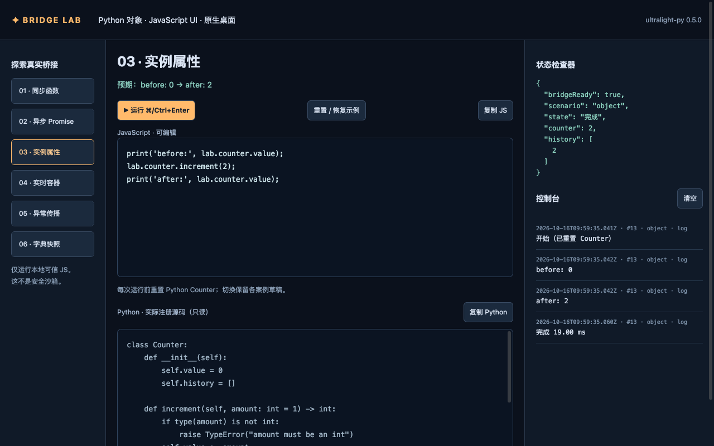

# Ultralight Bridge Lab

在 AppCore 原生窗口中同时编辑 Python 与 JavaScript，运行六类真实桥接示例：同步函数、asyncio Promise、实例、list 代理、异常和实时 dict。使用 Python 3.10+ 与 ultralight-py==0.6.0，无需浏览器、Node 或 Web 服务。



## 安装与运行

需要受支持的系统 wheel 和桌面环境。安装完成后运行无需联网。

```sh
cd examples/bridge-lab
python -m venv .venv
source .venv/bin/activate  # Windows: .venv\Scripts\activate
python -m pip install -e '.[test]'
python run.py
```

GPU 启动失败可用 `python run.py --cpu`。只需运行时可安装 `-e .`，不含测试依赖。

## 编辑与桥接

六个案例的两端代码均可编辑。点击运行或 Ctrl/Cmd+Enter，先将 Python 编译、执行为新模块，再运行 JS；JS 通过局部 `lab`（别名 `py`）访问模块的公开函数和对象。支持正常 Python 导入、多个函数、类、异步代码及本机文件访问。

例如将 Python 改为：

```python
import asyncio

async def square(value):
    await asyncio.sleep(0.1)
    return value ** 2
```

JS 改为 `print(await lab.square(7));`，得到真实结果 `49`。

- 每次运行重新初始化模块状态；切换保留两端草稿，重置恢复当前默认代码，退出后丢弃草稿。
- Python 编译或加载失败时不执行 JS，并保留上一版模块；已发生的文件写入等外部副作用不回滚。
- Python `print` 输出到启动终端；JS `print`、`console.log/warn/error` 输出到界面，日志最多 300 条、每条 4000 字符。
- Python list/dict 与 JS Array/Object 双向共享：直接使用索引、length、push、Object.keys 和 JSON.stringify。容器示例同时验证 JS 修改 Python list、Python 修改已有 JS 数组/对象，回传保留引用身份。Python 导出独立报告时显式使用 copy=True。
- Inspector 读取当前模块的 `counter.value/history`，未定义时显示空值。以 `_` 开头的名称遵循绑定库私有成员规则，不自动导出。
- 支持双端复制、系统编辑快捷键与 Tab 缩进；运行期间锁定编辑、切换和重复运行。

## 测试与截图

```sh
python -m pytest -q                         # 默认跳过原生测试
BRIDGE_LAB_NATIVE=1 python -m pytest -q      # 包含 AppCore 子进程
python run.py --smoke --smoke-report result.json
python run.py --cpu --smoke --screenshot docs/screenshots/bridge-lab.png
```

Windows PowerShell 用 `$env:BRIDGE_LAB_NATIVE='1'` 启用原生测试。冒烟测试自动退出，成功返回 0，失败非 0；截图来自真实 AppCore View 像素。报告按需生成，不纳入仓库。

2026-10-18 实测 macOS ARM64 / Python 3.14.6，GPU、CPU 原生冒烟通过；仓库全量测试 150 项通过。覆盖六个默认案例、双端修改、任意函数/类/导入/async、错误恢复、草稿、运行锁和日志上限。Windows/Linux、其他 Python 版本及 IME、剪贴板、多显示器尚未逐项验证。

## 实现与限制

所有 Runtime/View 操作在主线程，由 AppCore run/run_async 驱动；加载模块不重绑 API、不重入 evaluate，退出时清理动态模块、源码缓存与原生资源。代码在当前桌面进程执行，阻塞操作会阻塞 UI，退出语句会退出进程。

已按 0.6.0 安装源码与[官方 AppCore 示例](https://github.com/shabbywu/ultralight-py/blob/main/examples/appcore.py)核验：`wait_until` 接受 callable，检查 ready 前先等 `wait_settled`；ModuleType/SimpleNamespace 的动态成员无法直接被发现，因此用普通实例共享模块字典，导出真实对象代理。相对最初规格，Python 面板已全部改为可编辑，新增 `window.lab.run_python` 加载入口；JS 执行上下文中的 `lab` 指向本轮模块。

默认 1280×800，小于 1000px 时 Inspector 移到下方；内容最小宽度 580px，其余滚动。主动推送、导航恢复展示、日志导出与发行打包未实现。Ultralight SDK 和绑定遵守各自许可，商业分发需核验 SDK 授权。


## 0.6.0 容器迁移

list 改用原生 JS 数组接口，dict 直接取字段和枚举，无需 Python.to_value。
Python list 保持稠密，delete 或跳跃写入用 undefined 填充；原生 JS 创建的数组保留稀疏行为。
Python dict 的 JS 属性、Object.keys 和 JSON 只覆盖字符串键，其他键使用 Python.getitem 等高级接口。
求值默认返回共享 JSArray/JSObject 视图，原生冒烟报告使用 copy=True 复制为可 JSON 编码的基础数据。

2026-10-20：0.6.0 迁移在 macOS ARM64 / Python 3.13.0 下通过 18 项单元测试，CPU 与 GPU 原生冒烟各覆盖 21 个场景。
