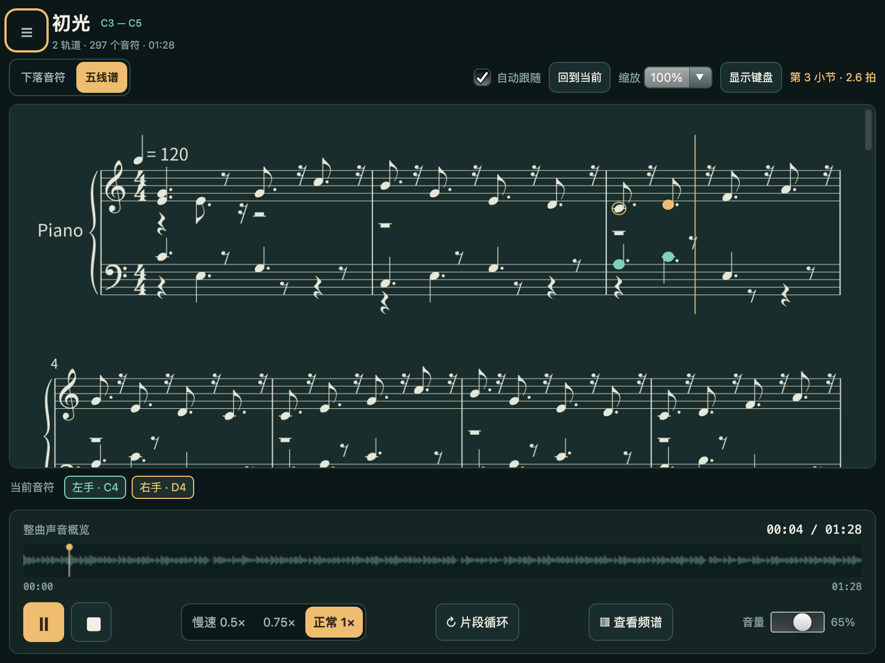

# PianoScope

看见音乐，认识琴键。原生 MIDI 钢琴播放器：Python 解析 MIDI、用随包 SoundFont 合成钢琴、输出音频并计算波形／频谱；本地 JavaScript 通过 `API("piano")` 控制播放器，Canvas 与大键盘呈现音乐。



源码与正式样本留在示例目录；个人 MIDI、调试与验证产物统一放入根目录 `.tmp/pianoscope/`，不提交。目录和路径配置见 [文件约定](docs/FILE_LAYOUT.md)。本文及验收文档指向 `.tmp` 的链接只用于本地查阅，新克隆不包含这些历史产物。

P0 功能已具备，自动验收与已知限制见 [VALIDATION.md](docs/VALIDATION.md)。人工耳听、端到端音画误差和其他平台仍未验证，因此不标为“全部 P0 验收完成”。

v1.1 已实现 MIDI 双谱表练习谱、预览／应用、A4 PDF／MusicXML 导出，以及复用原曲音频的五线谱跟随、定位和点击跳转。新增验收单独见 [v1.1 验收记录](docs/V1_1_VALIDATION.md)，规格见 [v1.1 增量规格](../../.tmp/pianoscope/specs/ultralight_pianoscope_spec_v1.1.html)。根据本轮用户确认，帧率验收目标为 **30 FPS 以上**。P2 仅保留 [离线演奏评估规划](docs/SCORE_ROADMAP.md)，不采集演奏。

## 安装与启动

本机验证：macOS 27.0.1 / Apple Silicon、Python 3.10.20。固定使用 `ultralight-py==0.5.0`；建议先使用 Python 3.10 创建独立环境。

```sh
cd examples/pianoscope
brew install fluidsynth portaudio cairo
python3.10 -m venv .venv
source .venv/bin/activate
python -m pip install -e '.[test]'
python run.py
```

也可使用已安装的 uv：

```sh
uv sync --python 3.10 --extra test --locked
uv run python run.py
```

`--cpu` 使用 CPU 渲染，`--file ./example.mid` 启动时打开文件。`--width 800 --height 600` 可复核小窗口。源码启动不下载音源，不需要 HTTP／WebSocket 服务、CDN、浏览器、Node.js 或 MIDI 硬件；安装依赖需要网络，安装后可离线运行。

FluidSynth／PortAudio／Cairo 是原生库。macOS 使用 Homebrew；可用 `PIANOSCOPE_FLUIDSYNTH=/完整路径/libfluidsynth.dylib` 指定库。Linux 通常需系统 `libfluidsynth3`、`libportaudio2` 及 Tk 文件对话框；Windows 需匹配架构的 FluidSynth DLL 和可用音频设备。这两个平台尚未验证，不宣称即装即用。

## 使用

- 品牌与文件打开入口位于左侧栏，独立顶部 header 已移除。左上角 ☰ 可展开／收起侧栏；宽度 ≤1100 px 时默认收起，点击遮罩、× 或 Escape 关闭。键盘模式、音名、静态音符和触键线位置仍在主区域直接操作。
- 选择“初光”或“泛音练习”，也可“打开单曲”。侧栏“选择文件夹”会列出该文件夹直属的 `.mid`／`.midi`（扩展名不区分大小写），支持搜索并点击切换；不递归子目录，最多 1,000 首。浏览文件夹保留当前播放，取消或扫描失败保留原列表；列表在本次会话内保留，换文件夹可重新扫描。准备后停在开头，点击播放；取消选文件保留当前状态，文件损坏时保留上一首曲目并暂停。
- 播放／暂停、停止、概览拖动跳转；Space 切播放，Home 回开头，左右方向键移动 2 个原曲秒。输入框、滑块和按钮保留自身键盘行为。
- 慢速 0.5×／0.75×／正常 1×：按事件时间重新生成钢琴声音，音高保持。主音量直接控制输出，不重新合成。
- 完整键盘显示 A0–C8 的 88 键；曲目键盘放大连续音域，保留未用的中间键。中央 C 固定为 C4。点琴键只查看音名、MIDI 编号与理论频率。
- “现在 · 按下”线代表当前播放时刻：音符下缘到线时按下对应琴键，上缘到线时松开。可上下拖动标签，或使用“触键线上移”滑块，在音符区底部向上调整 0–60%；0% 为琴键顶边。切换键盘、曲目和频谱面板保留当前位置。播放时线上同色标记与亮键对应；踏板延音不代表继续按键。
- 左手始终薄荷绿，右手始终暖金，未分配灰紫；双手同键以两色显示。实心按住与踏板延音轮廓分开，暂停不会保持发声高亮。
- 外部 MIDI 默认未分配。“左右手设置”按分配方式显示所需表单：按轨道时逐轨选择手别，按音高时只显示分界音和双手计数。先预览再应用；修改方式、轨道指派或分界音立即使旧预览失效。暂停后点音符或拖框选择，使用“指派左手／指派右手／清除分配”；可撤销。轨名只作线索。
- “只听左手／只听右手”真实过滤音频；未分配音符在单手模式排除。轨道设置支持静音和独奏，先过滤手别再应用轨道过滤。
- “片段循环”开启 A–B；可在概览拖动 A／B，或输入秒数后应用。区间至少 0.5 秒。停止保留选区，关闭循环也保留边界。
- “查看频谱”展开实际输出的短窗波形与频谱；整曲概览始终用于定位，不随主音量改变。暂停、停止、音量为零时实时图归零。
- 找不到设备时连接耳机或扬声器后“重试”；成功后等待用户播放。文件选择器不可用时可输入路径或使用 `--file`。

## 生成练习谱与跟谱

1. 打开 MIDI，选择“五线谱”或侧栏“制谱设置”。默认使用“自动整理（推荐）”；选择制谱轨道、谱表分配、拍号／调号来源与弱起长度，确认缺失元数据默认值后“生成预览”。轨道名与手别只是建议，谱表分配独立于左右手，不改变试听。
2. 预览可查看小节、谱表与量化提示；在制谱设置中点击提示可到达对应小节。检查后“应用谱面”。取消或失败保留旧谱；换曲或修改手别后，过期版本不能应用／导出。音量、变速、单手试听、轨道静音／独奏不使谱面过期。
3. 侧栏“导出 PDF”／“导出 MusicXML”先显示已应用版本的轨道与音符范围，再使用原生保存窗口。PDF 为真实 A4 纵向黑白谱面、中文曲名、自动分页和页码；MusicXML 为未压缩 `.musicxml`，附原始来源索引。保存取消不创建文件；临时文件写入成功后才替换目标。导出采用原曲速度，不受试听筛选影响。
4. 播放时，符头按实际可听源音符高亮；踏板尾音用轮廓区分。暂停清除发声高亮，保留小节游标。点击符头（含延音后段）、休止或小节跳转，沿用原有播放意图与 A–B 钳制。
5. 滚轮、触摸、滚动条或翻页键浏览会暂停“自动跟随”；“回到当前”恢复。缩放、视图切换和键盘折叠不重建声音。800×600 默认收起键盘，保留一整行双谱表和播放入口；触键线继续用于下落视图。

**自动整理（配置 2，规则 readable-v2.1，默认）**：先尝试十六分音符网格，将接近的和弦起点归并；常规时值优先，仅在连续细分节奏证据或真实快速／重复起音需要时使用更细网格或三连音。普通跨拍音符不强制拆成延音链；常规休止不会为了减少符号而改写成三连音，整小节休止只显示一个符号，空闲声部不堆叠休止。真正跨小节或和弦部分松键仍保留必要延音线。每谱表最多四声部，源索引保留每项推导；偏移超出整理容差会标记待检查，可切换分类查看全部整理记录。原始 MIDI、PCM、tempo map 和实际高亮区间不改。

**调号与谱号分开选择**：原曲含调号时默认沿用；缺失时默认提供“自动建议调号”，显示识别结果与关系调，允许手动改选。建议来自所选轨道的音高分布，不保证还原原谱，也不自动推断转调。谱号默认“自动（含八度标记）”，按每段实际音域在小节边界选择高／低音谱号及 8va／8vb；可改为仅自动高低音谱号，或固定上高下低。选择考虑加线和换谱号成本，避免逐音切换。音高、手别及上下谱归属保持独立，MusicXML 保存原音高与真实八度方向标记。

更新后请重启应用并重新生成预览，检查后应用；已有谱面不自动替换。本次分轨 Interstellar 的对照结果、PDF／MusicXML 及定向验证见 [节奏可读性与谱号验收](docs/READABILITY_VALIDATION.md)。

**严格量化（兼容记谱配置版本 1）**：以有理数四分音符拍计时；常规网格 1/4 拍，三连音配置为 1/4 与 1/3 拍网格的并集；起音与松键分别取最近点，等距向后，最大偏移 **1/10 拍（含边界）**。不把踏板尾音写成长按。短音塌缩、无法分解的复合时值、每谱表超过两个独立声部、零时值和中途变拍会具体报错，不省略源音符。支持 2/4、3/4、4/4、6/8 及小节边界变拍；弱起由用户确认，以四分音符为一拍，0 表示无弱起，尾小节补休止。

这是从演奏 MIDI 生成的练习谱，不承诺还原出版原谱。制谱上限：选定范围 5,000 个源音符、256 小节、32 页，另受底图解码／作业文件各 128 MiB、worker RSS 512 MiB 与 60 秒处理时间限制。超过范围明确拒绝，原曲仍可播放。

转谱失败会显示原因和问题列表；点击具体音符可暂停并跳到原曲位置。严格模式遇到零时值或演奏偏移时可尝试“自动整理”；声部拥挤时可检查上下谱的分配或选择需要的轨道。中央 C 只是初分建议，单轨 MIDI 不能据此保证还原左右手。算法不按曲名设置规则，也不保证任意 MIDI 都能完整表示。Interstellar 入门版、Rush E 和 Interstellar-Main-Theme 完整版已使用同一算法完整生成，实际 PDF／MusicXML 与验收见 [自动整理交付记录](docs/READABLE_VALIDATION.md)。原严格量化的失败诊断保留于 [历史记录](docs/CUSTOM_MIDI_VALIDATION.md)。

样本：[初光 PDF](docs/samples/v11/first-light.pdf) · [初光 MusicXML](docs/samples/v11/first-light.musicxml) · [极端音域／变拍／三连音 PDF](docs/samples/v11/edge-phrase.pdf)。独立 music21 逐项比对，MuseScore 4.6.5 导入并另存 PDF／可编辑 MSCZ，证据见验收记录。Music21、PyMuPDF 和 MuseScore 仅用于验证，不是产品运行依赖。

## 测试与真实截图

```sh
python -m pytest -q
python run.py --smoke --smoke-report ../../.tmp/pianoscope/validation/reports/native-gpu.json
python run.py --cpu --smoke --smoke-report ../../.tmp/pianoscope/validation/reports/native-offline.json
python run.py --cpu --smoke --audio-test --smoke-report ../../.tmp/pianoscope/validation/reports/native-audio.json
python run.py --smoke --audio-test --measure-seconds 60 --smoke-report ../../.tmp/pianoscope/validation/reports/native-gpu.json
python run.py --score-smoke --measure-seconds 60 --smoke-report ../../.tmp/pianoscope/validation/reports/v11-score-gpu.json
python run.py --cpu --score-smoke --width 800 --height 600 --smoke-report ../../.tmp/pianoscope/validation/reports/v11-score-800.json
python tools/score_gate.py
python tools/validate_score_outputs.py
python tools/minimal_gate.py
python tools/dialog_gate.py
# 人工确认原生文件选择：
python tools/dialog_gate.py --interactive
```

普通 smoke 检查真实 AppCore、JS binding、离线合成和交互，不要求输出设备；`--audio-test` 必须有实际输出设备，失败返回非 0。CPU smoke 通过 `View.copy_pixels()` 保存两种键盘的真实 PNG；GPU View 没有 CPU 像素面，因此 GPU smoke 不替代 CPU 截图。报告明确区分设备输出与离线渲染，包含版本、平台、断言、设备和失败原因。

[完整键盘截图](../../.tmp/pianoscope/validation/screenshots/pianoscope-full.png) · [真实有声分析截图](../../.tmp/pianoscope/validation/screenshots/pianoscope-playing.png) · [本地机器报告](../../.tmp/pianoscope/validation/reports/)

[800×600 主界面](../../.tmp/pianoscope/validation/screenshots/pianoscope-800x600-focused.png) · [小屏侧栏](../../.tmp/pianoscope/validation/screenshots/pianoscope-800x600-sidecar.png)

## 输入范围与工程约束

支持 MIDI Type 0/1、PPQN、全局 tempo／拍号、FIFO 音符配对、力度、CC64、CC7、CC11、all-notes／all-sound-off。固定钢琴音色；排除打击乐和 A0–C8 之外的音符并提示。Type 2、SMPTE、弯音、自定义调律等不在当前还原范围。

文件 ≤5 MiB、源曲解析 ≤600 秒（仍受声音缓冲预算约束）、note_on ≤50,000、总事件 ≤200,000、归一轨道 ≤16；超限拒绝导入，保留旧曲。极端同键重叠超过 256 个虚拟通道组合时明确报错，不静默截断。最多保留当前与准备中的两个 PCM 版本，总预算 192 MiB；另有引擎、解析和图形内存开销。

输出优先 48 kHz，设备不支持时尝试 44.1 kHz。合成任务按 2048 样本块检查取消，任务 generation 隔离，只有主线程发布版本。音频回调只读取已准备的缓冲、平滑增益并写入固定大小输出历史；设备 DAC 时间戳映射到源秒。前端仅做最多 250 ms 的短期插值，失联时停止外推。

实时琴键／外接 MIDI 输入、麦克风识别延后；外部 MusicXML 导入、WAV 导出与发行打包另列 backlog，不自动并入此次 P1。

## 代码与素材

`notation.py` 独立记谱；`readable.py` 节奏整理；`score_spelling.py` 调号建议与谱号规划；`score_worker.py`／`engraving.py` 隔离排版；`score_jobs.py` 预览／应用／导出事务；`assets/score.js` 跟谱；`pianoscope/midi.py` 时间线；`render.py`／`synth.py` 合成；`audio.py` 设备时钟；`session.py` 任务与状态；`hands.py` 分配；`analysis.py` 数学分析；`bridge.py` 显式绑定；`assets/` 本地 UI。测试夹具与演示曲均可通过 `tools/` 脚本重建。

本项目代码与原创 MIDI 为 [MIT](LICENSE)；SoundFont 和依赖保留各自许可、来源与校验值，见 [THIRD_PARTY_NOTICES.md](THIRD_PARTY_NOTICES.md)。

历史实施输入：[v1.1 开发提示词](../../.tmp/pianoscope/planning/V1_1_HANDOFF_PROMPT.md)（同规格第 12 节）。
