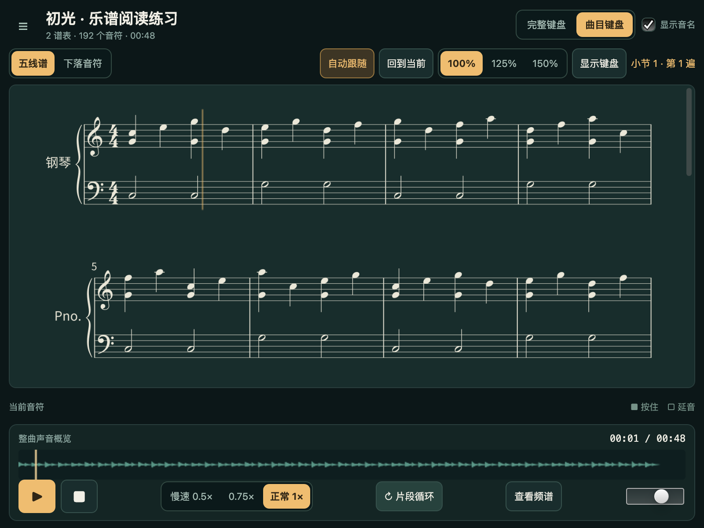

# PianoScope 2.0

以 MusicXML 为唯一曲目源的原生钢琴阅读与练习播放器。原乐谱直接排成五线谱；同一有理数语义生成真实 MIDI、播放实例和来源映射，沿用本地 SoundFont、FluidSynth 与设备 DAC 时钟。正式入口为 `run.py`，默认打开原创双谱表练习。

本轮实测平台为 macOS 27.0.1 ARM64、CPython 3.10.20、ultralight-py **0.5.0**。应用使用 AppCore、本地 HTML/CSS/JavaScript、Canvas 2D、`API("piano")`；无需 Web 服务、浏览器、CDN 或在线音源。其他系统尚未验收。结果、机器信息、失败记录和人工未测项见 [v2 逐项验收](docs/V2_VALIDATION.md)及 [UI 修正回归](docs/V2_UI_FEEDBACK.md)；[路线决策](docs/V2_DECISIONS.md)与[迁移记录](docs/V2_MIGRATION.md)说明实现边界。



从本目录安装并运行：

```sh
# Python 3.10+；锁文件固定依赖版本及下载哈希
uv sync --python 3.10 --extra test
uv run python run.py
uv run python run.py --file /绝对路径/乐谱.musicxml
uv run python run.py --cpu --width 800 --height 600
```

macOS 需本机原生库（本轮实测 FluidSynth 2.6.1、PortAudio 19.7.0、Cairo；安装方法 `brew install fluid-synth portaudio cairo`）。安装依赖需要网络；资源就绪后应用可离线加载、合成、播放和导出。内置 TimGM6mb SoundFont、中文字体和音乐字形及其许可随仓库保留，详见 [第三方声明](THIRD_PARTY_NOTICES.md)。验证专用 music21／PyMuPDF 不参与产品播放。SoundFont 与字体未替换。

打开乐谱或选择文件夹后，列表只显示当前目录的 `.musicxml`、`.xml`、`.mxl`，最多 1,000 项，不递归扫描；搜索按文件名过滤。MIDI 仅是派生导出格式，不接受 `.mid` 输入。加载期间当前曲继续可用；取消、解析／合成／页图失败或旧作业迟到都不会发布候选。全部页图解码就绪后，谱面、声音及版本一起切换到曲首，等待手动播放。

首次遇到缺少数值速度或两个独立单谱表 part 时，先确认默认四分音符速度或钢琴组合。确认绑定原件指纹与作业；原文件之后改变不替换已确认的字节。错误和仅显示不执行的记号可在“乐谱提示”分页查看，并附来源位置。原件及未知非执行元数据始终保留。

五线谱是默认视图，沿用原版深绿／金色布局与暗色阅读谱面；PDF 继续为白底打印。速度、缩放、反复遍次和手别均用直接展开的分段按钮，不使用原生下拉菜单或原生 radio；方向键可在按钮组中切换。可缩放 100／125／150%。点击符头、休止或小节空白定位；有反复时可选具体遍次，自动策略为当前遍次、之后最近一次、再回到首次。tie 后段定位到对应显示片段；该片段仍属于同一个播放实例。高亮由同一设备 DAC 快照的实例／源区间决定，踏板尾音显示边框。下落视图的短时位置插值只用于绘画，不产生音符、起音或播放时钟。

滚轮、触摸、滚动条或翻页会暂停自动跟随；“回到当前”恢复。小窗口侧栏改为抽屉，键盘默认折叠，保留整行双谱表和底部播放控件。空格播放／暂停，Home 回曲首，左右箭头跳 2 秒，PageUp／PageDown 浏览，Esc 关闭对话框；输入框与按钮保留自身键盘行为。

播放速度支持 0.5×／0.75×／1×，通过同一内核重合成以保持音高。波形可定位和拖动 A／B，也可输入时间；循环至少 0.5 秒，stop 回曲首并保留区间，下一次播放进入 A 点。音量作用于实际输出及分析。设备失败后可重试，恢复后等待手动播放。真实耳听、物理声画延迟和拔插尚未验证。

“试听范围”使用「全部｜上谱表｜下谱表｜静音」分段按钮，声部筛选折叠在下方；重新打开保留已经应用的选择，取消不会改动声音。“左右手设置”独立展示上／下谱表的分配，修改时直接显示预览数量，点击“确认分配”后生效，也可撤销。未确认时，上下谱表只是建议；侧栏「双手｜左手｜右手」可快速切换，未确认单手时先打开分配设置。撤销全部手别会回到双手试听。跨谱表 tie 的声音归属按链首，显示仍保留原谱位置。试听和手别标签不修改原件、谱面和默认全曲 MIDI。[试听范围界面](docs/screenshots/v2-audition-800.png)／[左右手设置界面](docs/screenshots/v2-hands-800.png)。完整 88 键布局为 52 白键、36 黑键，也可只显示曲目范围；琴键点击仅显示音高信息。触键线可上移 0–60%，不产生演奏输入。

导出可选 A4 PDF、**原文件副本**、派生 Type 1 MIDI。原件副本逐字节保留 XML 编码／MXL 容器，绝不是重新序列化的工作 XML。PDF 保留源记谱；默认 MIDI 是全曲、1×、全部谱表／声部，与试听无关。保存以绑定曲目的快照写同目录临时文件，校验并原子替换；取消和失败保留旧目标，已开始的保存即使换曲也完成原快照。拒绝覆盖当前输入源。工作 XML／MEI 是调试中间产物，不作为原件导出。

支持 profile `V2-P0-1`：MusicXML 3.1／4.0 `score-partwise`，一 part 双谱表或确认后的两 part 单谱表；G／F／C 谱号、调号与整数半音（A0–C8）、字面八度、backup／forward、稀疏声部、和弦成员独立时值、跨谱表、附点和 3:2／5:4／6:4／7:4 连音。时值直接采用 duration／divisions，不再乘 tuplet 比率，不量化、不猜调、不按四声部截断。拍号为 2/4、3/4、4/4、3/8、6/8、9/8、12/8；支持弱起及合法短尾小节。

固定发音策略 v1：无力度时 velocity=80；ppp/pp/p/mp/mf/f/ff/fff 分别为 24/36/48/60/76/92/108/120；数值 sound dynamics 按规范基准 90 换算并限制为 1–127。策略只影响派生声音与 MIDI，不改源文件。

普通非嵌套反复（2–16 次）、隐含前反复和一二结尾有界展开；tie 按实际路径合并，slur 不合并起音。节内 sound tempo／offset、metronome 附点单位、CC64 踏板、固定力度和无 tie 的 staccato 执行播放。direction/offset 默认只影响显示，`sound="yes"` 或 sound 子 offset 才影响播放；数值 sound 速度优先于 metronome，冲突会拒绝。8va／8vb 不重复更改源 pitch 的字面音高。

grace、导航 D.C./D.S./Fine/Coda、嵌套反复、微分音、非零 transpose、打击乐与未实现装饰音等带位置拒绝；fermata、accent、tenuto、渐强渐弱、rit. 等显示并明确提示未执行。歌词和复杂版式尚未系统验证；不保证与出版 PDF 像素相同。复杂异时值和弦／连音组合若固定排版器无法忠实表达会拒绝发布；缺失任何应显示符头也阻断。当前 SMF 限 15 个非打击乐重叠通道，PPQN 精确分母超出 32,767 拒绝，不舍入掩盖。

输入限 10 MiB，容器 256 项／单项 16 MiB／合计 32 MiB／100:1，禁止实体及外部文件、字体、图片和网络读取。源有音高 note ≤5,000、小节 ≤256；展开 ≤20,000 实例／1,024 小节出现／600 秒。最多当前＋候选两版本 PCM 合计 192 MiB；32 页，每页 2,000 字形；底图与作业产物各 128 MiB，worker 512 MiB／60 秒。慢速大曲可能先触及 PCM 预算；上限并不表示所有上限组合已经实测通过。

本轮原创可分享样本：[两页 PDF](docs/samples/v2/first-light.pdf)、[MusicXML 原件副本](docs/samples/v2/first-light.musicxml)、[真实 MIDI](docs/samples/v2/first-light.mid)、[源／实例／几何映射](docs/samples/v2/first-light.mapping.json)。原生截图和样本均来自实际运行，原创音乐使用本项目 MIT 许可。个人曲目、机器报告、调试截图与中间文件统一放仓库根 `.tmp/pianoscope/`，不进入提交。

定向测试按改动运行；完整发布命令和实测结果见验收页：

```sh
PYTHONDONTWRITEBYTECODE=1 uv run python -m pytest -q
uv run python tools/v2_g0_outputs.py
uv run python tools/validate_v2_outputs.py
uv run python run.py --cpu --width 800 --height 600 --file tests/fixtures/v2/printed.musicxml --smoke --audio-test --measure-seconds 60 --smoke-report ../../.tmp/pianoscope/v2/local-cpu.json
```

[v1.0](docs/VALIDATION.md)、[v1.1](docs/V1_1_VALIDATION.md)、[自定义 MIDI](docs/CUSTOM_MIDI_VALIDATION.md)、[旧 readable](docs/READABLE_VALIDATION.md)和[旧可读性](docs/READABILITY_VALIDATION.md)均为历史记录，不转记为 v2 通过。原生库、声音与视觉的人工未测限制继续保留。P2 仅规划，未开发演奏输入、麦克风、评分、完整制谱编辑器或发行打包；不自动 push。
