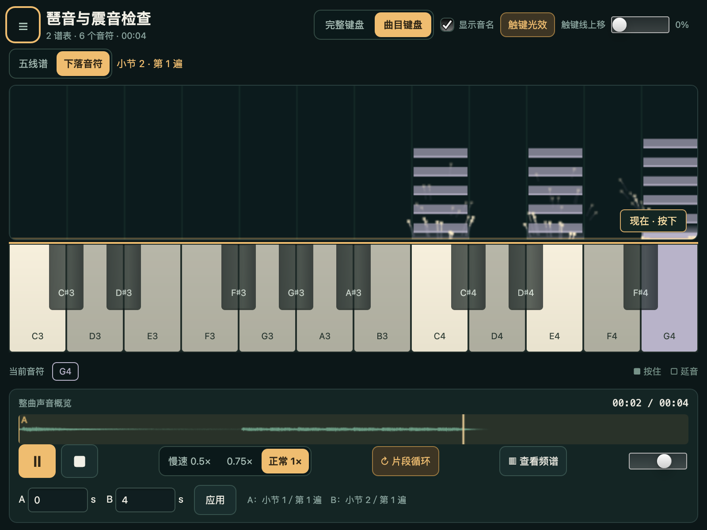
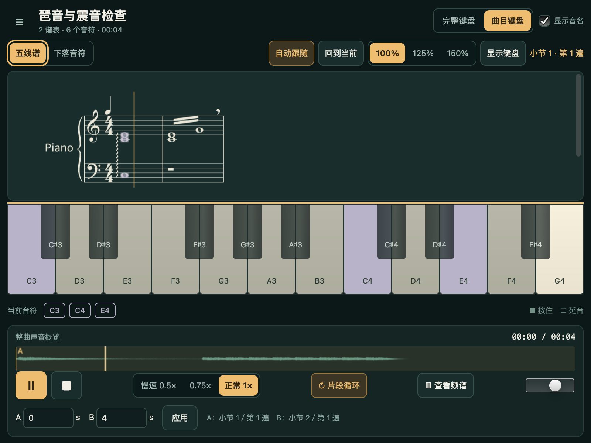

# 默认下落视图与 MusicXML 表现记号回归

2026-10-19，按用户反馈修正 `Forbidden Colours.mxl` 的导入阻断，并将首次打开改为下落音符。保留 Python 3.10.20、ultralight-py 0.5.0、AppCore、Canvas 2D、`API("piano")`、原 SoundFont／FluidSynth／PortAudio 与设备 DAC 时钟，没有新增运行依赖。原 G0、M5 和 v1.1 验收不改写。后续手别分配的缓冲复用及 512 MiB 预算见[独立修正记录](V2_HANDS_MEMORY_VALIDATION.md)；本页末尾的 192 MiB 限制保留为当时状态。

这次明确修改原规格的就绪条件：源语义、真实 MIDI、实例、PCM 一起提交后即可使用下落视图；此时没有排版作业、PNG、PDF 或底图解码，`layout_ready=false`、`layout_revision=null`。点击“五线谱”才启动绑定源版本的隔离排版作业，全部真实页图解码后单独原子发布布局。视图切换不重建播放器、不改变 PCM、倍率、循环或 DAC epoch。取消、过期、坏页图不会提交部分谱面，也不会撤销已可用的当前曲声音；可以回到下落音符或重新排版。源副本／MIDI 导出不等待排版，PDF 导出按已选快照独立排版。

profile 升为 `V2-P0-2`。琶音按源 number 分组，可跨谱表，默认向上，支持向下；采用明确播放策略：相邻起音间隔为 1/16 四分音符，短音收窄，原 release 不延长。它是项目播放规则，不是源文件声明的精确演奏时间。[MusicXML 琶音规范](https://www.w3.org/2021/06/musicxml40/musicxml-reference/elements/arpeggiate/)定义分组及方向。

定量单音／和弦震音，以及同小节同声部的相邻、等时值成对音／和弦震音，生成实际交替击奏，每次具有 MIDI 起止、实例、源 ID、显示区间和 DAC 高亮映射。划数与原 type 的附加符尾决定击奏间隔，原 duration 决定总时长，2:1 不重复缩放；依据 [MusicXML 震音规范](https://www.w3.org/2021/06/musicxml40/musicxml-reference/elements/tremolo/)。换气仅显示并提示不额外停顿；节拍器缺数值及组合力度有有效 sound 字段时采用该字段并诊断。同谱表同位置的顺序速度命令采用最后值并诊断，跨谱表／分部冲突仍拒绝。

个人文件还触发了编码分页越过 A4 页底。派生谱面先检查真实原生几何，超界时执行一次自动重新分页，再经过原有全部符头／休止、ID、打印边界和预算校验。该文件得到五页 PDF，原 MXL 的分页与字节保持不变。没有删除音符、放宽裁切检查或从 MIDI 转谱。

| 项目 | 实际结果及证据 |
| --- | --- |
| 解析／编译／事务回归 | [68 项通过](../../../.tmp/pianoscope/v2/loading-unit.json)：源守恒、跨谱表／向下／分组／短琶音、单音／和弦震音、反复、节内变速、独立 Mido 事件核对、歧义拒绝、试听／手别、取消／过期、PDF 按需导出及原子写入。重复 ZIP entry 恶意夹具产生 1 条预期 warning。 |
| 原创原生 CPU | [23 项通过](../../../.tmp/pianoscope/v2/loading-20261019-233628/report.json)：800×600 CSS、DPR=2；实际首屏约 0.40 秒，初始零排版；真实坏 PNG 解码拒绝、取消／重试、布局和三种导出、标题／播放控件可见。10 个逐秒窗口最低 34、平均 34.9 FPS，underrun=0。 |
| 原创原生 GPU | [22 项通过](../../../.tmp/pianoscope/v2/loading-20261019-233517/report.json)：1440×747 CSS、DPR=2；同一实际 DAC／布局／导出回归。10 个逐秒窗口最低 51、平均 52.8 FPS，underrun=0。 |
| 个人 MXL 原生 CPU | [实际播放／10 秒观测](../../../.tmp/pianoscope/v2/loading-20261019-233400/report.json)：1,631 个源音符，1,855 个播放实例／独立 SMF 起音，约 290.635 秒；约 1.5 秒进入下落视图，按需排版约 6 秒，10 个逐秒窗口最低 30、平均 30.3 FPS，underrun=0。该观测不代表整曲长时验收。 |
| 最终个人 MXL 交互复核 | [21 项通过](../../../.tmp/pianoscope/v2/loading-20261019-233759/report.json)：最后的 profile 身份更新后，复核取消、真实坏 PNG、重试、五页布局、三种导出、标题／播放按钮可见、PCM／DAC epoch 保持；本次 `--seconds 0`，性能明确 not_run，不新增性能通过。 |
| 正式 run.py 入口 | [51 项原生通过](../../../.tmp/pianoscope/v2/loading-entry.json)：新默认值、按需谱行、100／125／150% 点击、真实设备／静音、对话框取消、布局解码失败、换曲、十次循环、三档倍率、试听／手别和三种导出。没有运行 60 秒发布性能矩阵。 |
| PDF 视觉复核 | [PyMuPDF 1.27.2.3 独立渲染记录](../../../.tmp/pianoscope/v2/loading-20261019-233400/pdf-review/report.json)：逐页查看五页；未观察到谱行／页脚裁切，琶音、震音可见。Poppler 不在 PATH，使用既有独立渲染器，未新增依赖。部分密集和弦文字仍较拥挤，不宣称完全还原原出版排版。 |
| 原件及音乐产物 | [最终 PDF](../../../.tmp/pianoscope/v2/loading-20261019-233759/export.pdf)、[MXL 原件副本](../../../.tmp/pianoscope/v2/loading-20261019-233759/export.mxl)、[真实 MIDI](../../../.tmp/pianoscope/v2/loading-20261019-233759/export.mid)；MXL SHA-256 始终为 `1e1cf8410bb7c6fb6dcfdc24d5cf23fd53729aa97a157793684a2130c5413a8b`。个人曲目、产物、机器报告仅在根 `.tmp/pianoscope`，不进入提交。 |





两张正式截图逐字节复制自原生 CPU readback，没有图像生成或修图；来源为仓库原创 MIT 夹具 `tests/fixtures/v2/expressions.musicxml`（3 个琶音音符及 24 个震音击奏，共 27 次起音），不含个人作品。[截图校验清单](../../../.tmp/pianoscope/v2/loading-screenshot-manifest.json)。

复现命令，在 `examples/pianoscope` 执行：

```sh
.venv/bin/python -m pytest tests/test_v2_core.py tests/test_v2_profile.py tests/test_v2_expressions.py tests/test_v2_transactions.py -q
.venv/bin/python tools/v2_loading_gate.py
.venv/bin/python tools/v2_loading_gate.py --gpu
.venv/bin/python tools/v2_loading_gate.py --source '/本地路径/曲目.mxl' --seconds 0
.venv/bin/python run.py --cpu --width 800 --height 600 --smoke --audio-test --smoke-report ../../.tmp/pianoscope/v2/loading-entry.json
```

早期 [个人文件失败报告](../../../.tmp/pianoscope/v2/loading-20261019-233001/report.json) 和 worker 日志保留：当时编码分页超出 A4，谱面未发布、等待超时；后续通过没有覆盖该失败。原生报告、源文件指纹及提交前路径清单见根 `.tmp/pianoscope/v2/loading-*`。

自由震音、跨小节震音配对、琶音／震音与 tie／cue／staccato 的组合仍带位置拒绝；歌词、复杂和弦文字、全部装饰音和任意 MusicXML 完整互通没有系统验收。尚未排版时不宣称已验证五线谱几何。未测物理声画延迟、人工耳听、整首个人曲目连续播放、设备拔插、其他平台；本轮没有重跑 M5 的 60 秒发布矩阵，也不回填历史人工未测项。P2 仍仅规划。


本轮仍保留规格的当前＋候选 PCM 合计 192 MiB 上限。以这首约 290.635 秒曲目、44.1 kHz／双声道 float32 计算，含 2 秒尾音的一份 1× PCM 约 98.46 MiB；重新打开时两份约 196.92 MiB，会被拒绝，0.5× 单份也接近 196.24 MiB。它是全曲预合成与原子替换策略的内存预算，不是文件格式或曲目长度本身的限制。本轮未改缓冲方案或放宽预算；长曲慢速、换曲／重开仍有该限制，不能据首次成功导入宣称这些操作全部通过。
