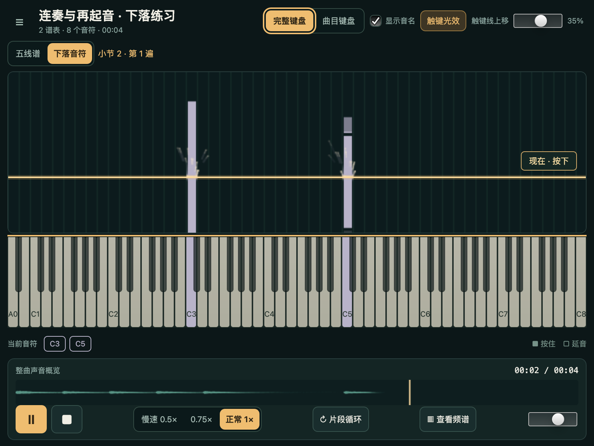

# 下落音符间隔与持续粒子尾迹 · 2026-10-19

同键连续再起音的音格补足约 4 CSS px 的视觉间隔，已有不少于 4px 的自然空隙不再加大。只裁短前一音格的尾端，下一音的起音位置不动；短音最多裁掉显示长度的 25%，极短音保持可见。真正由 tie 合并的持续音仍是一个完整音格，重叠声部保留各自时值与独立起音亮边。

按住期间，粒子持续从**完整琴键宽度**溅起，带弯曲尾迹向上、向两侧飞散；松键立即停止新增粒子，已有粒子继续运动并消散。每次实际再起音额外强调短闪。粒子使用独立轨迹及重力，寿命 440–640ms，尾迹覆盖最近 130ms 的运动；CPU／GPU 分别最多 128／256 颗。顶部“触键光效”控制开关；系统减少动态效果时保留接触高亮、关闭移动粒子和流光。

[查看实际原生连续动画](screenshots/v2-roll-trails-animated.png)。动画由 12 张实际窗口截图按实测间隔无损封装，每一帧解码像素均与原截图一致，未修改像素或补画效果。[逐帧核对](../../../.tmp/pianoscope/v2/roll-20261019-230732/animation-verification.json)。录制发生在性能窗口之前，不将截图采样频率作为 FPS 证据。



发射器只读取 DAC 快照确认的可听实例。暂停、隐藏下落视图、换版本、跳转会清除旧粒子；长音中途恢复允许继续喷射，不冒充再次起音。循环 A 点位于长音中间时也不制造起音闪光。快照超过 250ms 后停止新增，界面停顿后不补发积压粒子。动画时间仅决定装饰轨迹，不产生音乐事件。MusicXML、真实 MIDI、PCM、原 SoundFont 内核和设备 DAC 时钟保持原来的语义。

## 原生检查

环境：macOS 27.0.1 ARM64、CPython 3.10.20、ultralight-py 0.5.0；AppCore、本地 HTML/CSS/JavaScript、Canvas 2D、API("piano")、真实输出设备。GPU 未做 CPU readback；正式截图及动画来自 CPU 的实际 1600×1200 RGBA readback。

原创 `roll-articulation.musicxml` 直接编写为 MusicXML：C5 六次再起音，C3 跨小节 tie 持续四秒，末尾增加八分休止用于松键消散检查。8 个有音高源音符和 1 个休止形成 **7 个播放实例／7 个 SMF note-on**。独立 Mido 读取器核对，官方 MusicXML 4.0 本地 XSD 的 xmllint 检查通过。夹具和原生截图／动画沿用项目 MIT 许可。

| 原生条件 | 逐项结果 | 真实播放测量 |
| --- | --- | --- |
| CPU，CSS 800×600、DPR 2、完整 88 键，光效开启 | [27 项通过](../../../.tmp/pianoscope/v2/roll-20261019-230527/report.json) | 10 个完整、不重叠的一秒窗口均为 **30 FPS** |
| GPU，CSS 1440×747、DPR 2、完整 88 键，光效开启 | [27 项通过](../../../.tmp/pianoscope/v2/roll-20261019-230642/report.json) | 10 个完整、不重叠的一秒窗口均为 **30 FPS** |
| CPU，相同小窗口／键盘，光效关闭 | [27 项通过](../../../.tmp/pianoscope/v2/roll-20261019-230732/report.json) | 10 个完整、不重叠的一秒窗口均为 **30 FPS** |
| GPU，相同大窗口／键盘，光效关闭 | [27 项通过](../../../.tmp/pianoscope/v2/roll-20261019-230843/report.json) | 10 个完整、不重叠的一秒窗口均为 **30 FPS** |
| 正式 run.py 入口，CPU 800×600，默认五线谱 | [16 项通过](../../../.tmp/pianoscope/v2/roll-entry-fountain.json) | 不含播放性能测量 |

大窗口请求 1440×900，受本机屏幕可用高度限制，实际为 **1440×747**。性能窗口前留 0.25 秒供循环编辑区布局、设备启动稳定；测量期间不截图。四次均真实播放并经过实际循环，设备 underrun 为 0，源文件及编译 MIDI 字节不变，没有 JavaScript 错误。报告保存实际资源 SHA-256、版本、尺寸和逐项断言。关闭场景先验证效果，再点击可见按钮关闭后测量。

| 检查内容 | 证据范围 |
| --- | --- |
| 再起音间隔、最后松键、起音位置、tie 不切开 | 实际已绘制 Canvas 音格；另以相同几何函数检查全部六次起音 |
| 重叠声部、自然休止、极短音保护 | 原生 JavaScript 引擎中的手写边界数据，作为几何单元检查 |
| 光效与实际琴键等宽 | 实际绘制边界与独立 DOM 琴键宽度比较，误差小于 0.25 CSS px |
| 长音持续喷射，不依赖新的起音 | 真实设备播放到长音中间，起音短闪为 0，发射器持续存在，新粒子不断加入，同一在途粒子在两次采样间移动 |
| 松键后继续消散 | C5 进入末尾休止，实际发射器消失、在途尾迹仍存在，之后全部消散 |
| 暂停、长音中途定位、循环 A 点在长音中间 | 实际 API／设备播放，暂停清空，定位与循环启动不误造起音 |
| 重复 seq、epoch、循环回绕、减少动态效果 | 在原生引擎中给生产状态机提供手写快照／标志；不冒充设备或系统偏好交互证据 |
| 光效开关 | 实际 View 鼠标点击可见按钮并检查启停状态 |

## 刷新与资源控制

全键宽接触光晕、静态网格缓存，粒子按颜色和衰减批量绘制。动态粒子缓冲区仅覆盖当前喷射区域，并按块增长以减少反复分配；CPU 粒子层为 0.75 倍，GPU 为 1 倍，主音格画布沿用 CPU 1 倍／GPU 按 DPR 至多 2 倍。装饰轨迹由实例 ID 和发射序号确定，不使用随机音乐输出。

设备状态读取为 25ms；正式入口与工具共用 AppCore 宿主唤醒间隔 1/240 秒。二者服务显示与输入，设备 DAC 是唯一播放时间源。最小原生诊断复现过静态页面 rAF 停滞、可见 CSS 动画恢复刷新的条件，不宣称已证明 SDK 内部根因。Runtime.refresh_display 被原生库以“由外部宿主驱动”拒绝，产品不使用此路径。

早期候选的 16–29 FPS、冷启动／布局变化、循环测试设置顺序错误及诊断脚本失败均留在根 `.tmp/pianoscope/v2/roll-*` 和对应日志中。旧的起音短闪、光柱候选及早期通过记录不转记为本版持续粒子通过。最终证据以本页四份资源指纹一致的报告为准，v1.1 与旧 M5 机器报告不改写。

## 重跑与限制

从 examples/pianoscope 执行，每次创建根 .tmp/pianoscope/v2 下的新目录：

```sh
PYTHONDONTWRITEBYTECODE=1 .venv/bin/python tools/v2_roll_gate.py
PYTHONDONTWRITEBYTECODE=1 .venv/bin/python tools/v2_roll_gate.py --gpu
PYTHONDONTWRITEBYTECODE=1 .venv/bin/python tools/v2_roll_gate.py --effects-off --record
PYTHONDONTWRITEBYTECODE=1 .venv/bin/python tools/v2_roll_gate.py --gpu --effects-off
```

本轮为小型原创夹具的定向维护验收，未重跑 M5 的 60 秒发布矩阵，也未验证全部密度／最大资源上限曲目。其他系统、外接屏、系统减少动态偏好的真实切换、跨进程偏好恢复、人工听感与物理声画延迟未测。短于一次状态读取且未进入可听快照的音可能没有起音短闪；可听快照中的长音会持续发射。粒子层使用受限分辨率和数量，大量同时发音时不保证与少量音相同的粒子密度。

原有 [PDF／源副本／MIDI 指南](../README.md)、[v2 逐项验收](V2_VALIDATION.md)与历史记录独立保留。两份个人 MXL 未修改、未提交；预检与最终指纹核对留在根 .tmp/pianoscope/v2。
